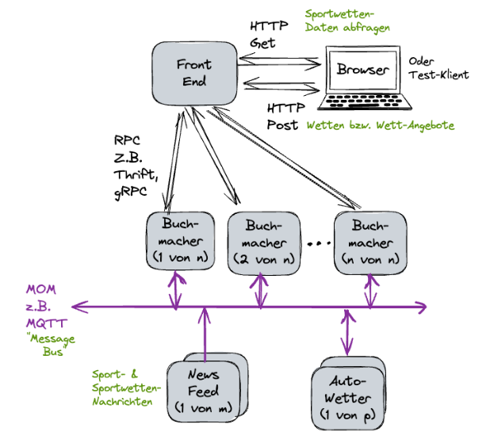

## was muss alles gestartet werden
- (Thrift)
- Python
- Socket
    - evtl. Thrift vorher neu machen
    - Python vorher zum verbinden
    - Pfad setzen
    - compilieren
    - ./client - starten

___
<h2 id="Thrift_einrichten">Thrift zum Laufen bekommen</h2>

- Tutorials:
    - https://thrift-tutorial.readthedocs.io/en/latest/installation.html
    - https://cloudxlab.com/blog/creating-thrift-service/
- **stehe im Dev-Container!!!**
- beim Bauen des Docker-Images wurden (aus unbekannten Gründen) einige Befehle, die vorgesehen waren, nicht ausgeführt -> muss händisch ausgeführt werden
-> Gründe sind nun bekannt: Docker merkt sich cd nicht
-> läuft jetzt direkt :D
- Vorsicht: dauert ne Weile
```
cd /
cd thrift-0.20.0
./bootstrap.sh
./configure
make               # dauert ne Weile
#(optional) make check
make install       # dauert ne Weile
```

___
## CPP-Client für Python Server starten
- [Thrift neu einrichten](#Thrift_einrichten)

### Python Server starten
```
cd socket/RPCWettanbieter/server/
python3 PythonServer.py
```

### neuen CPP-Client (= socket.cpp) starten
Umgebungsvariable (Path) setzen && Kompilieren der Dateien im gen-cpp Ordner:
```
export LD_LIBRARY_PATH=$LD_LIBRARY_PATH:/thrift-0.20.0/lib/cpp/.libs
cd socket/httpSocket/
g++ ../RPCWettanbieter/gen-cpp/Wettanbieter_types.h ../RPCWettanbieter/gen-cpp/Wettanbieter.h ../RPCWettanbieter/gen-cpp/Wettanbieter.cpp defines.h socket.cpp -o http-server -lthrift
./http-server
```

___
## Wenn ein RPC-File (+Thrift) geändert wurde
- **Vorsicht**: in gen-cpp ist der Client mit drin - **nicht löschen**
- Ordner gen-py / gen-cpp löschen

wenn Wettanbieter.thrift Datei geändert wurde müssen die Dateien neu generiert werden:
``` 
cd socket/RPCWettanbieter/
thrift --gen cpp Wettanbieter.thrift
thrift --gen py Wettanbieter.thrift
```

___
## Überblick


| Feld | Datei | Port | Aufruf | Pfad |
| --- | --- | --- | --- | --- |
| Browser | .html | 8080|  | Socket/x.html |
| FrontEnd HTTP-Schnittstelle | socket.cpp | 8080 | ./Socket | Socket/httpSocket/socket.cpp |
| FrontEnd RPC-Schnittstelle | socket.cpp | 9090 | ./client (Auto)| Socket/httpSocket/socket.cpp |
| Buchmacher | PythonServer | 9090 | python3 PythonServer.py | /socket/RPCWettanbieter/server/PythonServer.py |

___
## .gitignore
Wenn Files bereits im Repo sind, können sie so gelöscht werden\
-> bleiben im lokalen working directory erhalten
```
git rm --cached file
git rm --cached .
```

___
## Tests P2
- CPP-Client Ausführen
- Zeit steht im Terminal
```
cd socket/RPCWettanbieter/gen-cpp/
export LD_LIBRARY_PATH=$LD_LIBRARY_PATH:/thrift-0.20.0/lib/cpp/.libs
g++ Wettanbieter_types.h Wettanbieter.h Wettanbieter.cpp CppClient.cpp -o test-client -lthrift
./test-client
```
